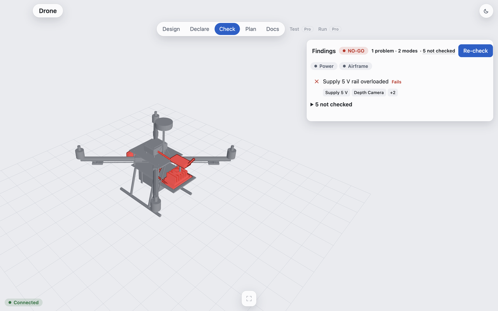
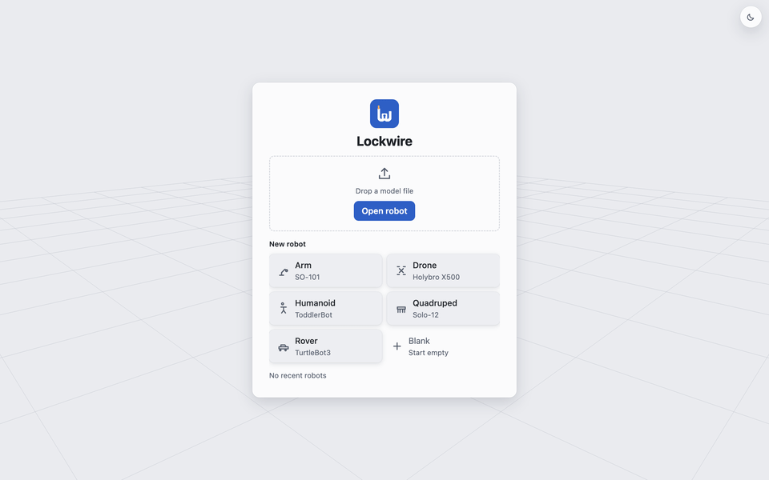

<p align="center">
<picture>
  <source media="(prefers-color-scheme: dark)" srcset="docs/img/logo-dark.svg">
  
</picture>
</p>

**Find out your robot won't work before you buy the parts.**



Every robot is a stack of numbers from a dozen datasheets: what each part weighs, what each power rail can supply, how much the bus can carry, how much torque each joint gets. Lockwire keeps those numbers in one file and tells you the moment they stop adding up. Use it while you're still planning a build, then keep it in CI so a part swap can't quietly break it later.

## Try it in 30 seconds

Needs Python 3.12 or newer (the Python that ships with macOS is older).

```bash
pipx install lockwire
lockwire start --example servo-bench
lockwire check
```

```console
VIOLATION budgets/bud.power.servo-5v — observed 32.10 W, expected <= 15.00 W (Δ +17.10 W (+114%))
  dependent: dev.pi5, dev.servo1, dev.servo2, dev.servo3, dev.servo4
  ...
NO-GO — 1 violation(s), 0 warning(s)
```

A Raspberry Pi 5 and four servos on one 3 A regulator: caught before you ordered either.

## Try it on your robot

Point it at your URDF and see what it flags:

```bash
lockwire start path/to/robot.urdf
lockwire check
```

No URDF? Start from the example and swap in your parts:

```bash
lockwire start --example servo-bench
lockwire add device lockwire.yaml --id dev.servo5 --family fam.servo --model mod.mg996r --rail rail.servo-5v --draw "6 W" --mass "55 g" --owner you --source "MG996R datasheet" --witness Sam
lockwire check
```

See `lockwire add --help` for rails, budgets and the rest.

## Download the app

The free desktop app does the same visually. Get it from the [latest release](https://github.com/Shivansh2703/lockwire/releases/latest).



- **macOS (Apple silicon):** unzip, open Lockwire. The first open shows a warning because the app is not notarized: open System Settings, Privacy & Security, scroll down and click "Open Anyway".
- **Linux:** `chmod +x Lockwire-*.AppImage`, then run it. Ubuntu 22.04 needs `sudo apt install libfuse2`; Ubuntu 24.04 needs `sudo apt install libfuse2t64`.
- **Windows app:** not yet.

## Other ways to use it

**Command line.** Make a lockfile and check it from a terminal.

```
pipx install lockwire
```

```
lockwire start --example drone
```

Starters: `lockwire start --example <name>` with drone, rover, arm, quadruped or humanoid. Add your own: see [CONTRIBUTING](CONTRIBUTING.md).

```
lockwire check lockwire.yaml
```

**Desktop app.** Download it above, click a New robot starter, or open your own lockfile.

```
https://github.com/Shivansh2703/lockwire/releases/latest
```

**GitHub Action.** Run the check on every push and keep an HTML report.

```
- uses: actions/checkout@v4
- uses: Shivansh2703/lockwire@v0
  with:
    contract: lockwire.yaml
```

**AI agents (MCP).** Let Claude Desktop, Claude Code or Cursor check your robot before it acts.

```
pipx install "lockwire[mcp]"
```

```
claude mcp add lockwire -- lockwire mcp
```

```
{
  "mcpServers": {
    "lockwire": { "command": "lockwire", "args": ["mcp"] }
  }
}
```

Claude Code: the claude mcp add line. Claude Desktop: put the JSON in claude_desktop_config.json. Cursor: put the JSON in .cursor/mcp.json (or ~/.cursor/mcp.json). If the app cannot find lockwire, use the full path from which lockwire. Then ask: Check my robot's lockwire.yaml and explain the NO-GO.

**Agent plan and what-if.** Score an intended plan, or a proposed change, before anything executes.

```
lockwire plan lockwire.yaml plan.yaml
```

```
lockwire what-if lockwire.yaml --change "devices/dev.onboard-computer/physical/mass=300 g" --source "my scale" --witness me
```

plan.yaml holds steps, for example: steps: [{kind: rail_load, rail: rail.supply-5v, draw: {value: 10, unit: W}}]

**Python library.** Call the same check from your own script.

```
import lockwire.api as lw
print(lw.check("lockwire.yaml")["verdict"])
```

**ROS, preflight and the local API.** The go/no-go gate for a powered-on robot, ROS and the local server.

Part of Lockwire Pro.

### Features

- **Check:** See which numbers do not add up. `lockwire check lockwire.yaml`
- **Declare a fact:** Set one value with a source and a witness. `lockwire declare lockwire.yaml devices/dev.power-module.pm02-v3/physical/mass "25 g" --source "my scale" --witness me`
- **Add a part:** Add a device, rail, bus or battery block. `lockwire add --help`
- **Design (place, move, rotate, reparent):** Put a part in the 3D model and move it. Switch on the Power, Data and Mechanical connection views to see them drawn on the robot, and use W, A, S, D to move the camera. `lockwire move lockwire.yaml dev.power-module.pm02-v3 --offset 0.01,0,0.02 --unit m --source "tape measure" --witness me`
- **Plan and what-if:** Score a plan or a change without editing the lockfile. `lockwire plan lockwire.yaml plan.yaml`
- **Report:** Write one HTML page to share. `lockwire report lockwire.yaml -o report.html --no-open`
- **Describe:** Write a reference sheet per part. `lockwire describe lockwire.yaml --out ref`
- **History (diff, log, blame):** See what changed, by whom, and why (needs git). `lockwire diff`
- **Scene:** Read part positions from a 3D model. `lockwire scene import --help`
- **Gearbox:** Add a gearbox with its ratio and joints. `lockwire gearbox --help`
- **Upgrade:** Write a new lockfile from an older one. `lockwire upgrade --help`

## A real-world example: the X500 drone

```bash
git clone https://github.com/Shivansh2703/lockwire && cd lockwire     # the X500 example lives in the repo, not the wheel
lockwire check tests/fixtures/x500/contract.yaml
```

Output (trimmed):

```console
$ lockwire check tests/fixtures/x500/contract.yaml
VIOLATION budgets/bud.power.pm02-5v — observed 35.20 W (draw mode: nominal), expected <= 15.60 W (Δ +19.60 W (+126%))
  dependent: dev.camera.oak-d-lite, dev.companion.jetson-orin-nano, dev.radio.rfd900x
  owner: power-integration
  action: shed load on rail 'rail.pm02-5v' or raise its capacity with provenance
VIOLATION budgets/bud.power.pm02-5v.7w-mode — observed 17.20 W (draw mode: 7W), expected <= 15.60 W (Δ +1.60 W (+10%))
  … (same rail, Jetson in its 7 W mode: the radio's transmit peak still tips it over)
not scored budgets/bud.mass.payload — observed mass unknown for dev.companion.jetson-orin-nano, dev.camera.oak-d-lite, dev.magnetometer.ist8310; total not scored, expected every device and link in this budget to declare a mass
  … (more not-scored lines: things the lockfile does not declare yet, listed, never hidden)
scored 9: 7 add up, 2 do not · 10 not scored

NO-GO — 2 violation(s), 0 warning(s)
$ echo $?
1
```

## What just happened

A Holybro PM02 power module publishes a regulated 5 V rail at 3 A: 15.6 W. An NVIDIA Jetson
Orin Nano publishes a 25 W power mode at 5 V: 5 A. Put a camera on the same rail and the
published parts **cannot power the published companion computer**. This is a custom
integration of published parts, and the two vendors' own numbers still do not add up.

Nobody printed "this build is broken". Nobody printed "5 A" either: that is 25 W / 5 V, a
quotient of figures published on different pages. The records disagree with each other, and
you find out before you apply power. Give the Jetson its own regulator
(`tests/fixtures/x500/contract_corrected.yaml`) and the same check passes: `GO — records agree (10 scored); 10 check(s) not scored`.

## Your own robot

`lockwire start` reads links, joints, masses and the structure hash from your URDF or SDF. A fresh
lockfile knows the frame and nothing else; fill in devices, rails and buses as you go, and
`check` lists what it still could not check.

A lockfile whose `schema_version` this lockwire does not recognise is refused before any check runs.
`check` prints `REFUSED — contract declares schema_version '0.99'; this lockwire supports 0.2, 0.3, 0.4` and exits 2.
A lockfile at an older supported version is accepted as-is, with no automatic upgrade.

Re-running `lockwire start --force` on the same URDF is destructive:
re-declare every fact in the lockfile by hand, because no command carries those facts forward.
Any field you hand-edited (including `robot.name`) is silently overwritten back to the URDF-derived value.

## Exit codes

| command | 0 | 1 | 2 | 3 |
|---|---|---|---|---|
| `check` | `GO`, `GO with notes` | `NO-GO` | a contract that could not be found, read, or parsed | `NOT SCORED` (nothing compared) |
| `start` | the contract was written (or an existing one kept); no page is written | the URDF/SDF could not be parsed, or the contract could not be read or written | — | — |

`NOT SCORED` (exit 3) means no comparison had both operands: it is not a pass and not a failure.

The `scored N: …` line above the verdict is where a script should look.
`lockwire check --strict` makes a `GO with notes` run exit 1 (the `NO-GO` code); the table does not change.

## In CI

```yaml
- uses: actions/checkout@v4
- uses: Shivansh2703/lockwire@v0        # composite action: installs lockwire, runs the check, uploads an HTML report
  with:
    contract: lockwire.yaml
```

Inputs: `contract` (default `lockwire.yaml`), `version` (pin a PyPI release; default installs the action's own code), `strict` (default `false`; `true` passes `--strict`), `python-version` (default 3.12).
Or just `pipx install lockwire && lockwire check lockwire.yaml`.

## Pre-commit

```yaml
repos:
  - repo: https://github.com/Shivansh2703/lockwire
    rev: v0.2.3
    hooks:
      - id: lockwire-check
```

Runs `lockwire check` (on `lockwire.yaml` in the repo root) whenever a lockfile changes.

## What it checks

Each check compares **two separately declared figures**, each with its own provenance line.
It shows who said what; it cannot verify that a datasheet is true.

| check | source A | source B |
|---|---|---|
| rail power budget | device draw (datasheet) | rail capacity (power module datasheet) |
| rail tree rollup | child rail draw / efficiency | parent rail capacity |
| torque budget | joint effort limit (URDF) | actuator continuous torque x gear ratio |
| bus bandwidth | message rate x payload | bus bitrate x utilisation ceiling |
| mass budget | per-device mass | declared total |
| endurance | pack energy | summed draw |
| voltage compatibility | rail voltage | device input voltage range |
| reference integrity | every `bus_ref`, `mount_frame`, dependency edge | the thing it points at |

No physics simulation, no machine learning, no network. The answer is the same twice.

## Free and Pro

- **Free forever (this repo):** the lockfile, all deterministic checks including
  power/thermal/bus/link/torque budgets, edit / describe / plan / what-if, the MCP server, the
  HTML report, and the desktop planning app (Open, Design, Declare, Plan, Check).
- **Lockwire Pro** is the paid tier (powered-on preflight, recording analysis).

## Development

See [CONTRIBUTING.md](CONTRIBUTING.md). Python 3.12 or newer; runtime dependencies are
pydantic, typer, rich, ruamel.yaml and numpy.

## Licence

Apache-2.0. See [LICENSE](LICENSE).
