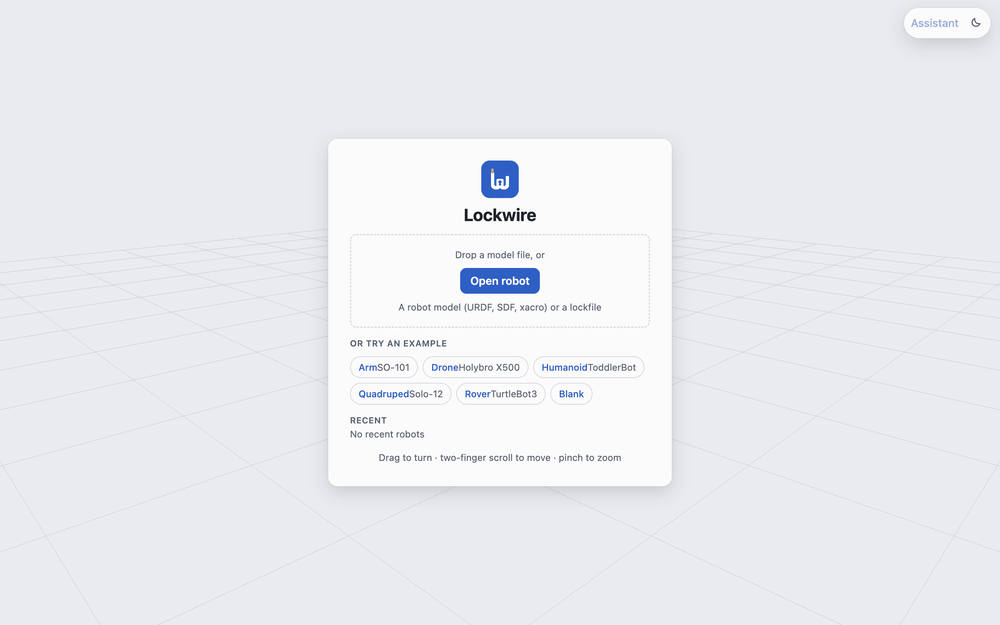

<p align="center">
<picture>
  <source media="(prefers-color-scheme: dark)" srcset="docs/img/logo-dark.svg">
  
</picture>
</p>

**From idea to robot: catch the error in your robot model before the real robot does.**

## Try it on your robot

Needs Python 3.12 or newer and [uv](https://docs.astral.sh/uv/). Point it at your URDF, xacro or SDF (nothing is written):

```bash
uvx lockwire check robot.urdf
```

What you see, on the public TurtleBot3 Waffle Pi URDF:

```console
$ uvx lockwire check turtlebot3_waffle_pi.urdf
VIOLATION datasheet/turtlebot3-waffle-pi/mass_total — observed URDF sum of link masses: 1.554, expected ROBOTIS TurtleBot3 Waffle Pi
datasheet: 1.8 kg; the sheet's figure includes the battery, computer and sensors
(Δ -13.7%)
  source: https://emanual.robotis.com/docs/en/platform/turtlebot3/features/
  ...
NO-GO — 1 violation(s), 3 warning(s)
  ...
Lock it so CI catches drift: uvx lockwire start turtlebot3_waffle_pi.urdf
```

The model's links add up to 13.7% less than the maker's own published weight. Lockwire found
that without being told, named the page it came from, and printed the next command. Errors like
this are in public robot models today: [the fixes sent upstream](docs/ledger.md).

## Lock it

```bash
uvx lockwire start robot.urdf
```

This writes `lockwire.yaml`, the robot's physics lockfile: every link's mass, centre of mass and
inertia, every joint limit, and a hash of the model's structure. Commit it next to your model.
From now on `uvx lockwire check` checks the lockfile, and a mass or joint limit edited in the
model without re-locking is a NO-GO that names the value.

## Run it in CI

```bash
uvx lockwire agent-setup --ci
```

That writes `.github/workflows/lockwire.yml`. Its step, with the three inputs most repos need:

```yaml
- uses: actions/checkout@v4
- uses: Shivansh2703/lockwire@v0
  with:
    contract: lockwire.yaml    # the lockfile
    # model: robot.urdf        # or check a model directly, with no lockfile
    # adopt: "true"            # annotate and report, but never fail the job
```

A NO-GO fails the build, with annotations on the pull request and an HTML report.
Every input, pre-commit and other CI systems: [docs/guides/ci.md](docs/guides/ci.md).

## Let your AI agent check it

```bash
claude mcp add lockwire -- uvx --from "lockwire[mcp]" lockwire mcp
uvx lockwire agent-setup
```

The first line gives Claude Code the checks over MCP. `agent-setup` writes the agent rules into
AGENTS.md and the Claude Code one, plus a pre-commit hook and the CI workflow.
Cursor, Claude Desktop and other agents: [docs/guides/agents.md](docs/guides/agents.md).

## No robot file? Try an example

servo-bench is built to fail: a 5 V rail overloaded and a wrist servo too weak, on purpose, so you can see what a catch looks like.

```console
$ uvx lockwire start --example servo-bench
wrote lockwire.yaml — example servo-bench (built to fail: a 5 V rail overloaded and a wrist servo too weak, on purpose, so you can see what a catch looks like). Next: uvx lockwire check lockwire.yaml
$ uvx lockwire check
VIOLATION model/joints/wrist/limits/effort — observed 0.40 N*m joint effort limit, expected <= 0.226 N*m, the feetech.scs0009
stall torque (Δ 1.8x the stall torque)
  ...
  action: ... or find a stronger servo: lockwire swap lockwire.yaml wrist
VIOLATION budgets/bud.power.servo-5v — observed 32.10 W, expected <= 15.00 W (Δ +17.10 W (+114%))
  ...
NO-GO — 2 violation(s), 0 warning(s)
```

The five robots (`--example drone`, `rover`, `arm`, `quadruped`, `humanoid`) are clean
starting points; try your own robot for the catch.

### Features

- **Check:** see which physical numbers in your model do not add up, and the command that fixes each one.
- **Lock:** keep those numbers in `lockwire.yaml`, so any drift is caught.
- **CI:** the same check on every push, with pull-request annotations and an HTML report.
- **Agents:** your AI coding agent runs the same check before it changes the robot.

Everything else (datasheet comparisons, power, torque and bus budgets, part swap, the servo
recorder, drift on a single robot, the Python library): [the guides](docs/guides/index.md). The powered-on
preflight gate, ROS 2 bags and the drift ledger across units are Lockwire Pro, waitlist only: https://lockwirerobotics.com.

## Download the app

The free desktop app does the same visually: [latest release](https://github.com/Shivansh2703/lockwire/releases/latest).



- **macOS (Apple silicon):** unzip, open Lockwire. The app is not notarized, so the first open warns: open System Settings, Privacy & Security, and click "Open Anyway".
- **Linux:** `chmod +x Lockwire-*.AppImage`, then run it. Ubuntu 22.04 needs `sudo apt install libfuse2`; 24.04 needs `libfuse2t64`.
- **Windows:** not yet.

Want it installed instead of run through uvx? `pip install lockwire`, then drop the `uvx`.

## Development and licence

See [CONTRIBUTING.md](CONTRIBUTING.md). Apache-2.0, all of it: see [LICENSE](LICENSE).
